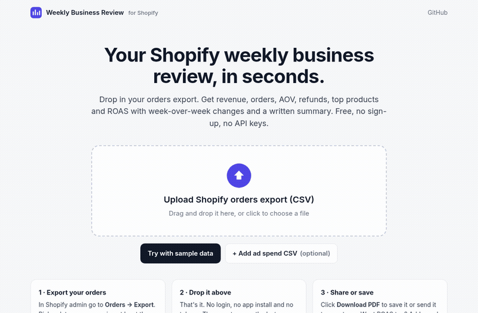
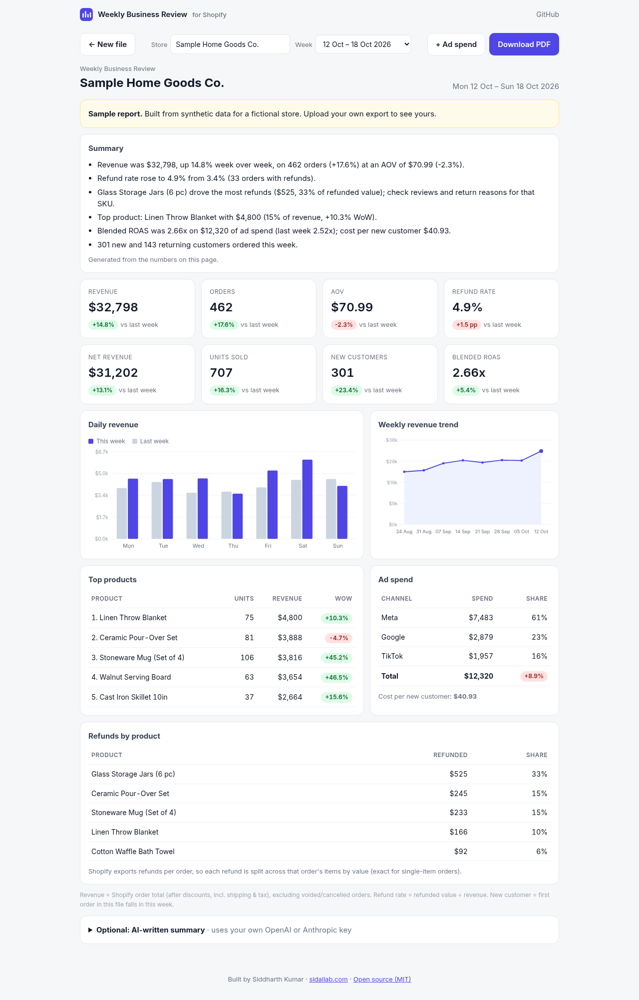

# Shopify Weekly Business Review

**Drop in your Shopify orders export, get a weekly business review in seconds. Free, no sign-up, and nothing leaves your browser.**

### 👉 [Open the app: madebysid.github.io/shopify-wbr](https://madebysid.github.io/shopify-wbr/)

No install, no login, no API keys. Click **Try with sample data** to see a full report straight away.



## How to use

1. **Export your orders.** In Shopify admin go to **Orders → Export**, pick a date range covering at least the last two weeks (8 weeks gives the full trend), choose **CSV for Excel, Numbers, or other spreadsheet programs**, and click **Export orders**.
2. **Open [the app](https://madebysid.github.io/shopify-wbr/) and drop the CSV in.** You can optionally add an ad spend CSV with `date,channel,spend` columns ([template](site/sample/ad_spend_template.csv)) to get ROAS and cost per new customer.
3. **Read, then share.** Switch weeks from the dropdown and click **Download PDF** to save or send it.

## What's in the report

- Revenue, orders, AOV, net revenue, units, refund rate and new customers, each with week-over-week change
- Daily revenue this week vs last week, and an 8-week revenue trend
- Top products, with each product's WoW change
- Refunds by product, to see which SKU is behind a refund spike
- Ad spend by channel, blended ROAS and cost per new customer (if you add ad spend)
- A written summary of what changed. Optionally, an AI-written version using your own OpenAI or Anthropic key.



*The sample report uses synthetic data for a fictional store, not a real business.*

## Privacy

- The app is a static page. Your CSV is read and processed **in your browser tab only**. There's no server, no upload, no analytics and no cookies.
- The AI summary is off unless you paste your own API key. The key stays in the tab's memory (it isn't saved), and only the aggregated numbers shown on the page are sent to the provider you pick. No customer emails or order rows are sent.

## How metrics are defined

- **Revenue**: Shopify order `Total` (after discounts, including shipping and tax), excluding voided and cancelled orders. **Net revenue** subtracts `Refunded Amount`.
- **AOV**: revenue / orders. **Refund rate**: refunded value / revenue, with the WoW change in percentage points.
- **New customer**: an email whose first order in the file falls in the reported week. Export more history for a more accurate split.
- **Refunds by product**: Shopify exports refunds per order, so each refund is split across that order's items by value. This is exact for single-item orders.
- **Blended ROAS**: revenue / total ad spend. **Cost per new customer**: ad spend / new customers.
- Weeks run Monday to Sunday. The report defaults to the last complete week in the file.

---

## For developers

The web app is plain HTML, CSS and JavaScript (ES modules) with no build step and no dependencies.

```
site/            the web app (deployed to GitHub Pages)
  index.html     landing page and report view
  app.js         UI, charts, file handling
  wbr.js         CSV parsing, metrics, summaries (pure functions, shared with tests)
  sample/        synthetic sample data
test/            JS tests (node:test)
cli/             Python command-line version (same metrics)
```

Run locally:

```bash
git clone https://github.com/madebysid/shopify-wbr.git && cd shopify-wbr
npm run serve        # http://localhost:8000
npm test             # JS metric tests (Node 20+)
```

### Command-line version

If you'd rather script it, for example a Monday cron job that emails the PDF, there's a Python CLI with the same metrics in [`cli/`](cli/):

```bash
cd cli && pip install -e .
wbr ../site/sample/orders_sample.csv --ads ../site/sample/ad_spend_sample.csv --pdf
```

See [cli/README.md](cli/README.md) for options. Tests: `cd cli && pip install -r requirements-dev.txt && pytest`.

Sample data is generated by [`cli/scripts/generate_sample_data.py`](cli/scripts/generate_sample_data.py) with a fixed seed. The last week includes a promo push and a refund spike on one SKU, so the report has something to say.

## Why I built this

I work in ecommerce: first at Amazon on the Global Store in MENA, and now as Technical Director at EcomVest, where I build the internal systems for around 50 Shopify stores. One of those systems turns the P&L into weekly and monthly business review decks automatically. This is a small, generic, open-source take on the same idea. It shares no code or data with that system.

Built by **Siddharth Kumar** · [sidailab.com](https://sidailab.com) · [LinkedIn](https://www.linkedin.com/in/sidkmr)

## License

MIT
